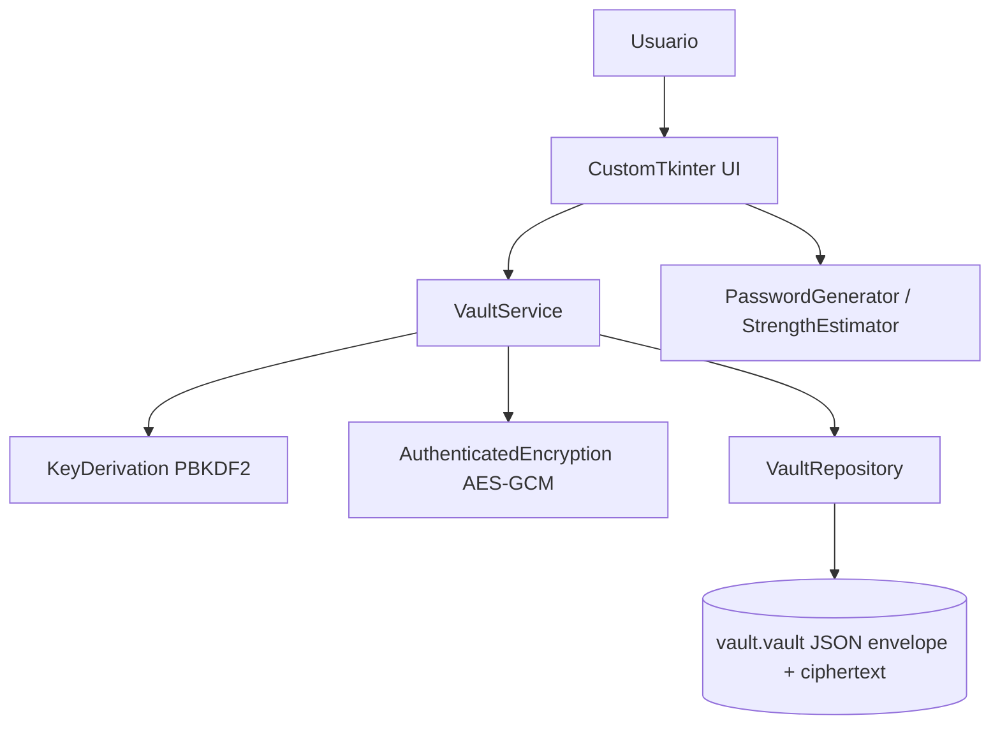

# Arquitectura técnica

Rediseño posterior: MainWindow separa Mi bóveda y Aprender criptografía en páginas
desplazables con navegación persistente. LaboratoryView renderiza LabReport.steps,
diagramas Canvas y un explorador de entropía con GeneratorPolicy; sus preguntas y
progreso son locales. Cambiar sección limpia entradas/ediciones sin tocar la sesión.
Los cálculos siguen en su worker aislado. Destroy cancela polling explícitamente.
Detalle y evidencia actual: INTERFACE_REPORT.md.

## Implementación vigente T-006–T-012

`VaultService` agrega list_credentials/get_credential/add/update/delete. Cada
mutación crea un candidato validado; `_persist` cifra, guarda con expected y solo
entonces instala el snapshot. Los fallos de almacenamiento descartan la sesión.

`AccessController.operate` comparte el mismo executor de acceso y bloqueo. Los
resultados `VaultResult` llevan filas (id/nombre/usuario), y Credential solo para
detalle/copiar solicitado; repr excluye esos campos. Los resultados de acceso
conservan su contrato anterior sin secretos. Tk consume la cola y descarta generaciones
anteriores; el worker no toca widgets. Los argumentos de edición se liberan al terminar.

`VaultView` renderiza metadatos y `CredentialDialog` mantiene campos solo mientras
se edita. Revelado de 10 s; cierre/bloqueo limpia tabla, diálogo y portapapeles.
`ClipboardManager` compara antes de limpiar y cancela el temporizador previo al recopiar.
`password_generator` y `strength` son servicios puros, sin GUI o red.

`LaboratoryView` ejecuta `run_experiment` en un worker independiente sin acceso a
la bóveda, con consulta del Future desde Tk y errores sanitizados. Muestra fórmulas,
parámetros públicos y resultados de referencia/autenticación; nunca claves o maestra.

Los apartados de infraestructura T-001–T-005 de abajo reflejan su alcance histórico.

## 1. Estilo
Aplicación de escritorio de proceso único, modular, offline. UI depende de servicios; servicios dependen de interfaces de criptografía/almacenamiento, nunca a la inversa. Separación para permitir tests sin GUI.



## 2. Módulos propuestos
- `ui/`: vistas desbloqueo, bóveda, edición, generador, seguridad; controladores ligeros, estados visuales y portapapeles.
- `domain/`: modelos tipados `Credential`, `Vault`, validadores sin acceso a archivos ni claves.
- `services/vault_service.py`: casos de uso `create_vault`, `unlock`, `lock`, `list`, `add`, `update`, `delete`, `save`; coordinación transaccional en memoria.
- `services/password_generator.py`: aleatoriedad vía `secrets`, estimación documentada de entropía y reglas visuales de fortaleza.
- `crypto/key_derivation.py`: configuración PBKDF2, sal aleatoria, clave de 32 bytes.
- `crypto/encryption.py`: AES-GCM con nonce aleatorio de 12 bytes único por cifrado, AAD para enlazar metadatos; gestionar fallo de autenticación sin detalles de secreto.
- `storage/vault_repository.py`: validación estricta de formato/versiones, lectura y escritura atómica, permisos cuando aplique.
- `tests/`: unitarios, integración, escenarios adversos. No probar algoritmos criptográficos reinventándolos.

## 3. Flujos
**Creación**: validar maestra -> sal aleatoria -> PBKDF2 -> serializar bóveda vacía -> nonce -> AES-GCM con AAD -> guardar envelope atómicamente -> mostrar bóveda.

**Apertura**: leer/validar envelope acotando tamaños y parámetros -> derivar clave -> autenticar+descifrar -> validar JSON interno -> cargar en memoria -> mostrar tabla.

**Edición**: modificar snapshot lógico en memoria -> serializar y volver a cifrar con nonce fresco -> escritura atómica -> UI reporta éxito solo después de confirmar escritura.

**Bloqueo**: eliminar referencias a claves y credenciales de estado de la app y mostrar bloqueo. Python no garantiza borrado criptográfico de memoria.

## 4. Trabajo en segundo plano
PBKDF2 puede tardar: ejecutar por worker sin interactuar directamente con widgets desde el hilo secundario. Devolver solo resultado/estado al hilo UI mediante mecanismo seguro de despacho. Deshabilitar acciones durante desbloqueo y evitar operaciones concurrentes sobre el archivo.

## 5. Estructura base
```text
src/vaultlab/
  app.py
  ui/{unlock_view,vault_view,credential_dialog,generator_view,security_view}.py
  domain/{models,validation}.py
  services/{vault_service,password_generator,strength}.py
  crypto/{key_derivation,encryption}.py
  storage/{vault_repository,format}.py
  config.py
 tests/{unit,integration}/
```

## 6. Decisiones de diseño
Sin servidor ni DB, no persistir plaintext temporal, servicios aislables para tests, un archivo cifrado por instalación/demo. Diseño de `password_strength` debe dejar claro que una puntuación heurística no equivale a entropía real de contraseñas humanas.

## 7. Implementación de infraestructura T-003

- `domain/models.py`: snapshots inmutables `Credential` y `Vault`, validación sin I/O.
- `storage/format.py`: serialización y parseo estrictos de sobre e interior, en memoria.
- `storage/vault_codec.py`: adaptador puro `seal_vault`/`open_vault`; transforma el
  snapshot usando el motor de T-002, sin archivos, caché de claves ni estado de sesión.
- `storage/vault_repository.py`: creación exclusiva, lectura y guardado atómico de
  `EncryptedData`; nunca acepta el modelo en claro ni la contraseña maestra.

La composición comprobada es `Vault → seal_vault → repository.create/save` y
`repository.read → open_vault → Vault`. La aplicación futura debe autenticar el
snapshot leído antes de autorizar cambios. El guardado recibe `expected` y rechaza
un archivo que ya difiera de él; no se implementa bloqueo interproceso.

El códec pertenece al adaptador de representación, no crea/desbloquea una sesión.
`services/` y la GUI no se modifican en T-003; los casos de uso siguen en T-004.
La criptografía no depende de dominio, almacenamiento ni interfaz.

## 8. Servicio implementado en T-004

`VaultService` depende de `VaultRepositoryPort` (read/create/save de paquetes
cifrados) y compone las primitivas/serializers existentes. El repositorio concreto
de T-003 satisface el protocolo sin modificaciones. No cambia el códec sin estado
de T-003: el servicio deriva una sola vez para conservar la clave de la sesión.

Métodos de este ticket: create_vault, unlock, lock y save sin argumentos; propiedades
state y snapshot de solo lectura. No hay list/add/update/delete ni reemplazo público
del snapshot. CRUD sigue reservado para T-006 y las vistas para T-005.

La sesión privada contiene el modelo inmutable, clave derivada y paquete previo.
Solo se instala al terminar autenticación/validación y, al crear, persistencia.
lock descarta toda la referencia. El estado se calcula desde la presencia de sesión,
sin una bandera independiente que pueda quedar inconsistente.

save exige sesión y usa como expected el paquete autenticado previamente o el último
generado y guardado exitosamente en esa sesión. El paquete siguiente se cifra con
nonce nuevo; se actualiza la referencia solo después del éxito del repositorio.
Un fallo de guardado descarta la sesión. expected solo controla conflictos secuenciales,
sin bloqueo interproceso. El servicio es síncrono y requiere acceso serializado;
T-005 deberá ejecutarlo fuera del hilo UI sin permitir operaciones superpuestas.

## 9. Acceso gráfico implementado en T-005

- `app.py` ensambla VaultService y VaultRepository mediante una fábrica inyectada;
  ruta inicial local `cwd/vault.vault`, sin configuración persistida.
- `ui/access_controller.py`: executor de un worker, cola de resultados y generación
  de operación. Todas las llamadas al servicio y su estado ocurren en ese worker,
  incluida creación por la fábrica y bloqueo; no hay llamadas superpuestas.
- `ui/access_view.py`: formulario en Tk, maestra/confirmación ocultas, validación
  UTF-8 y confirmación exacta, selección de archivo, progreso y mensajes controlados.
- `ui/main_window.py`: acceso desplazable, indicador fijo de laboratorio obligatorio
  P0, aviso académico, bloqueo y cierre. Solo muestra un estado autenticado mínimo.

El worker nunca toca widgets ni llama a after. Tk consulta la cola cada 40 ms;
los resultados solo contienen generación, booleano de sesión, mensaje fijo y error.
No se transfieren credenciales, claves, maestras ni objetos de excepción a la GUI.
La vista no solicita snapshots ni llama a save: no hay operaciones de edición en T-005.

Bloquear o cerrar invalida generaciones anteriores y encola lock en el mismo worker.
Los resultados viejos se descartan incluso si ya estaban en cola. Durante la espera
no se permite otro acceso; cerrar destruye la ventana tras confirmar el bloqueo.
La destrucción directa de Tk tiene una limpieza de respaldo que encola lock y cierra
el executor sin esperar en el hilo gráfico. No se modifica el servicio síncrono.
