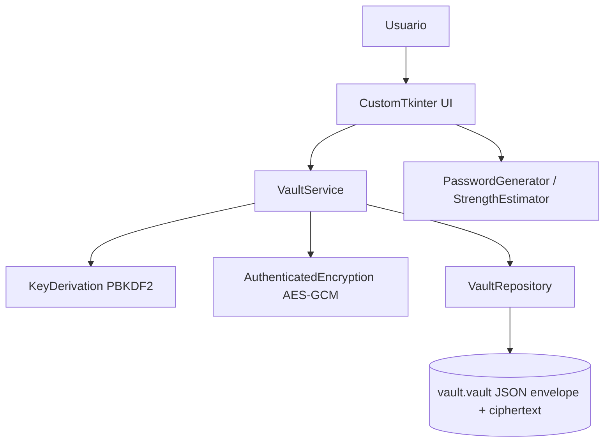

# Arquitectura técnica

## 1. Estilo
Aplicación de escritorio de proceso único, modular, offline. UI depende de servicios; servicios dependen de interfaces de criptografía/almacenamiento, nunca a la inversa. Separación para permitir tests sin GUI.



## 2. Módulos propuestos
- `ui/`: vistas desbloqueo, bóveda, edición, generador, seguridad; controladores ligeros, estados visuales y portapapeles.
- `domain/`: modelos tipados `Credential`, `Vault`, validadores sin acceso a archivos ni claves.
- `services/vault_service.py`: casos de uso `create_vault`, `unlock`, `lock`, `list`, `add`, `update`, `delete`, `save`; coordinación transaccional en memoria.
- `services/password_generator.py`: aleatoriedad vía `secrets`, estimación documentada de entropía y reglas visuales de fortaleza.
- `crypto/key_derivation.py`: configuración PBKDF2, sal aleatoria, clave de 32 bytes.
- `crypto/encryption.py`: AES-GCM con nonce aleatorio de 12 bytes único por cifrado, AAD para enlazar metadatos; gestionar fallo de autenticación sin detalles de secreto.
- `storage/vault_repository.py`: validación estricta de formato/versiones, lectura y escritura atómica, permisos cuando aplique.
- `tests/`: unitarios, integración, escenarios adversos. No probar algoritmos criptográficos reinventándolos.

## 3. Flujos
**Creación**: validar maestra -> sal aleatoria -> PBKDF2 -> serializar bóveda vacía -> nonce -> AES-GCM con AAD -> guardar envelope atómicamente -> mostrar bóveda.

**Apertura**: leer/validar envelope acotando tamaños y parámetros -> derivar clave -> autenticar+descifrar -> validar JSON interno -> cargar en memoria -> mostrar tabla.

**Edición**: modificar snapshot lógico en memoria -> serializar y volver a cifrar con nonce fresco -> escritura atómica -> UI reporta éxito solo después de confirmar escritura.

**Bloqueo**: eliminar referencias a claves y credenciales de estado de la app y mostrar bloqueo. Python no garantiza borrado criptográfico de memoria.

## 4. Trabajo en segundo plano
PBKDF2 puede tardar: ejecutar por worker sin interactuar directamente con widgets desde el hilo secundario. Devolver solo resultado/estado al hilo UI mediante mecanismo seguro de despacho. Deshabilitar acciones durante desbloqueo y evitar operaciones concurrentes sobre el archivo.

## 5. Estructura base
```text
src/vaultlab/
  app.py
  ui/{unlock_view,vault_view,credential_dialog,generator_view,security_view}.py
  domain/{models,validation}.py
  services/{vault_service,password_generator,strength}.py
  crypto/{key_derivation,encryption}.py
  storage/{vault_repository,format}.py
  config.py
 tests/{unit,integration}/
```

## 6. Decisiones de diseño
Sin servidor ni DB, no persistir plaintext temporal, servicios aislables para tests, un archivo cifrado por instalación/demo. Diseño de `password_strength` debe dejar claro que una puntuación heurística no equivale a entropía real de contraseñas humanas.
