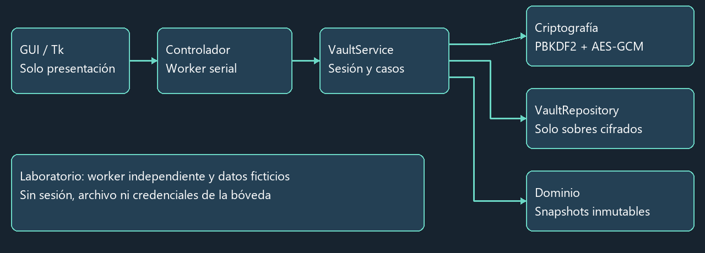
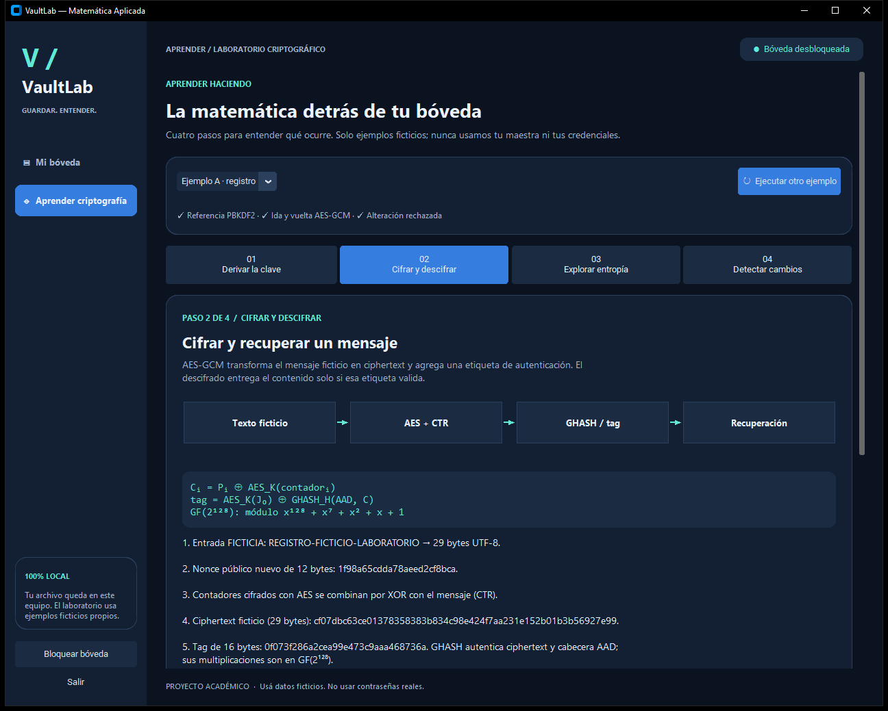
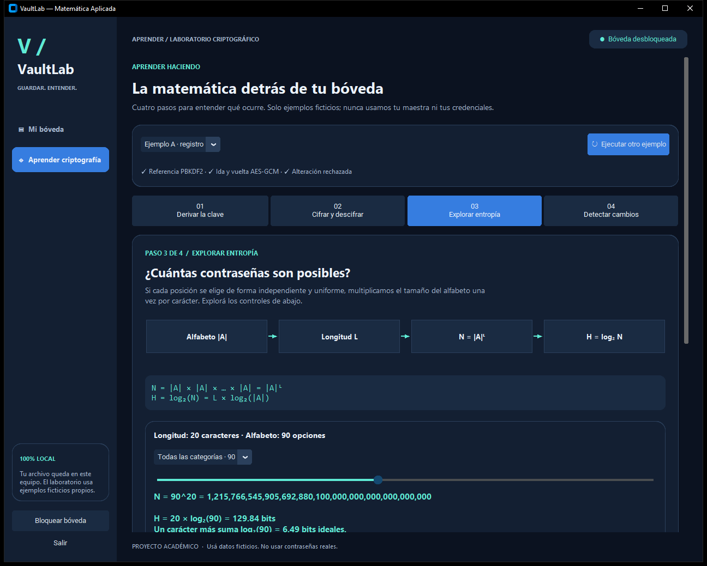
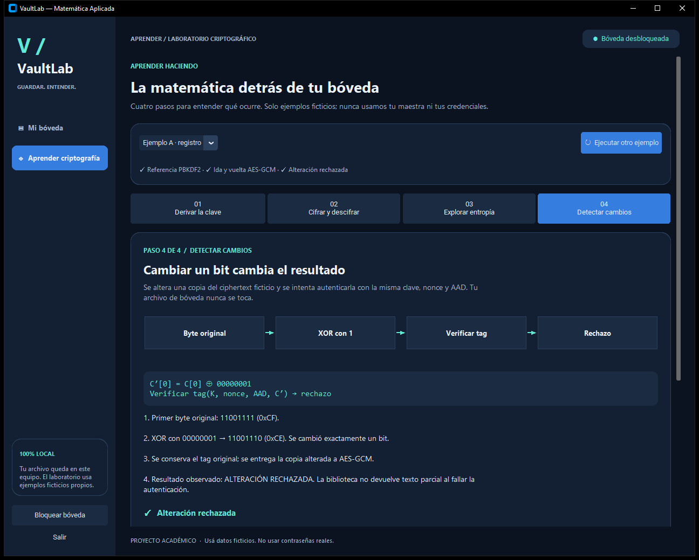

# VaultLab: gestión local de credenciales y visualización matemática

## VaultLab: Local Credential Management and Mathematical Visualization

**Borrador académico — 25 de octubre de 2026.** Autoría, institución y asignatura:
completar por el equipo. Este texto sigue la estructura REDDI transcripta en
PAPER_GUIDE.md; falta cotejarlo y maquetarlo con la plantilla Word docente original,
ausente en el repositorio. No representa una publicación ni una certificación.

## Resumen

Se presenta VaultLab, una aplicación educativa de escritorio para administrar
credenciales en una bóveda local cifrada. La solución separa interfaz, servicios,
dominio, criptografía y persistencia. Una contraseña maestra permite derivar una
clave mediante PBKDF2-HMAC-SHA256; AES-256-GCM protege confidencialidad e integridad
del archivo. Se implementaron creación, apertura, búsqueda, altas, modificaciones,
bajas, generación aleatoria y copiado con limpieza condicional. Un laboratorio
independiente muestra ecuaciones y verifica operaciones con datos ficticios,
incluyendo el rechazo de una alteración del ciphertext. Las pruebas cubren estados,
autenticación, formato, fallos de escritura y flujos gráficos. Se distinguen la
entropía ideal de cadenas uniformes y un indicador heurístico para entradas humanas.
El alcance no comprende malware, eliminación garantizada de memoria, historial del
portapapeles ni uso concurrente entre procesos.

**Palabras clave:** criptografía; PBKDF2; cifrado autenticado; entropía; interfaz didáctica.

## Abstract

VaultLab is an educational desktop application for managing credentials in a local
encrypted vault. Its architecture separates the interface, application services,
domain model, cryptography, and storage. A master password derives a key through
PBKDF2-HMAC-SHA256, while AES-256-GCM protects file confidentiality and integrity.
Implemented features include vault creation and unlocking, searchable credential
management, random password generation, and clipboard copying with conditional
cleanup. An independent laboratory displays mathematical expressions and checks
operations using fictional data, including ciphertext tampering rejection. Tests
cover authentication, state transitions, file validation, write failures, and
graphical workflows. Ideal entropy for uniformly sampled strings is distinguished
from a heuristic indicator for human passwords. The application does not address
malware, guaranteed memory erasure, clipboard history, or concurrent processes.

**Keywords:** cryptography; PBKDF2; authenticated encryption; entropy; educational interface.

## I. CONTEXTO

El trabajo corresponde al tema Administrador de Contraseñas de Matemática Aplicada.
La especificación local identifica como exigencias docentes la bóveda cifrada,
gestión de registros, GUI, generador, fortaleza, búsqueda, copiado y explicación
matemática visible. Python, CustomTkinter, AES-GCM, JSON y la división en capas son
decisiones de implementación. La trazabilidad depende de documentos transcritos:
no se auditaron las consignas originales ausentes. El sistema es local, offline y
mono-usuario. Se utilizan exclusivamente credenciales ficticias.

## II. INTRODUCCIÓN

El objetivo es conservar credenciales entre sesiones sin escribirlas en claro y
explicar cómo intervienen derivación, aleatoriedad y autenticación. El adversario
considerado obtiene una copia del archivo, pero no controla el proceso ni conoce
la maestra. Una maestra débil sigue admitiendo ataques por diccionario. El modelo
no protege un escritorio comprometido; presentar la herramienta como producto
certificado excedería las evidencias disponibles.

## III. MÉTODOS

### Derivación y cifrado

PBKDF2 [1] aplica repetidamente una función seudoaleatoria. Aquí PRF es HMAC-SHA256,
P es la maestra, S la sal y c el coste:

`U₁ = PRF(P, S || INT₃₂_BE(i)); Uⱼ = PRF(P, Uⱼ₋₁)`

`Tᵢ = U₁ XOR … XOR U꜀; DK = (T₁ || … || Tₗ)[0:dkLen]`.

Como dkLen=hLen=32 bytes, basta T₁. La aplicación conserva el coste inicial ya
calibrado de 2.400.000 iteraciones, acepta 600.000–5.000.000 y genera sal de 16 bytes.
El laboratorio contrasta una traza reducida c=2 con una implementación de referencia;
no utiliza ese coste reducido para cifrar la bóveda. Solo muestra tamaños y fórmulas,
nunca U ni la clave derivada. El coste dificulta intentos, no crea entropía en P.

GCM [2] combina cifrado por contador y autenticación: `Cᵢ = Pᵢ XOR AES_K(ctrᵢ)`.
GHASH acumula bloques mediante operaciones en GF(2¹²⁸) con polinomio
`x¹²⁸+x⁷+x²+x+1`. El tag combina GHASH con AES aplicado al bloque inicial J₀.
El nonce de 96 bits es nuevo en cada cifrado; el tag tiene 128 bits. La biblioteca
autentica antes de devolver texto claro. La cabecera canónica es AAD: cambiar coste,
sal, nonce, algoritmos o versión impide una apertura válida. No se implementan
AES ni HMAC propios.

### Generación y fortaleza

Cada carácter se elige mediante `secrets.choice` [3] sobre un alfabeto sin duplicados.
Las categorías están permitidas, sin forzar su presencia. Con L posiciones
independientes y equiprobables, `N=|A|ᴸ` y `H=log₂(N)=L log₂|A|`. La configuración
predeterminada usa L=20 y |A|=90: H≈129,84 bits. Esta cifra describe el proceso de
generación, no una contraseña humana ni un tiempo de ataque. El indicador visual
es otra herramienta: umbrales de longitud 8/12/16/20 y penalización de patrones
comunes, secuencias y repetición. Es una heurística limitada, sin diccionario exhaustivo.

### Arquitectura y persistencia

`GUI → controlador serial → servicios → dominio / criptografía / repositorio`.
El worker posee la sesión y serializa acceso, lectura y mutaciones. La GUI recibe
solo metadatos de tabla; una acción explícita solicita detalle o copiado. Los
resultados obsoletos se descartan al bloquear. El laboratorio usa otro experimento
aislado que jamás recibe el servicio ni la ruta de la bóveda.

El repositorio recibe exclusivamente sobres cifrados. Un temporal cifrado se
sincroniza y publica por reemplazo atómico; la creación es exclusiva. Cada mutación
crea un candidato inmutable, guarda y solo después publica su estado. Un conflicto
o fallo de escritura bloquea y exige reapertura. No existe bloqueo interproceso.

## IV. RESULTADOS Y OBJETIVOS

Las evidencias ejecutables se conservan en `docs/evidence/pytest.xml` y el informe
`FINAL_REPORT.md`. El recuento definitivo, entorno y comandos están en ese informe;
no se extrapolan los resultados a otra plataforma ni a una auditoría de seguridad.
En Windows 10 x64 con CPython 3.13.5, la evaluación del rediseño aprobó 284 pruebas
en 91,24 segundos, con GUI habilitada, sin errores, omisiones ni advertencias.
Los resultados específicos del recorrido se documentan en INTERFACE_REPORT.md.

| Objetivo | Evidencia reproducible |
|---|---|
| Persistencia de CRUD | `tests/integration/test_crud.py`: reinicio y recuperación |
| Fallos sin pérdida de archivo previo | inyección de fsync y conflictos externos |
| Generación y supuestos | combinaciones de categorías, límites y fuente CSPRNG |
| Ocultamiento y limpieza | `test_vault_gui.py`, `test_clipboard.py` |
| Didáctica matemática | referencia PBKDF2, ida-vuelta y alteración rechazada |
| Regresión | suite previa de autenticación, formato adverso y repositorio |

Las siete capturas provienen de ventanas reales renderizadas; el generador oculta
la salida y las rutas se reemplazaron visualmente por un nombre ficticio antes de
capturar. El laboratorio tiene su propia página accesible desde el menú lateral,
cuatro pasos con diagramas, resultados reales y preguntas con devolución. La
longitud y el alfabeto se pueden variar para observar la sustitución numérica de H.
No son mockups. La inspección de capturas no sustituye pruebas manuales de teclado,
escalado y usabilidad en el equipo de exposición.

## V. CONCLUSIONES

La implementación reúne gestión persistente y demostración matemática sin usar
datos reales. Las garantías verificadas son acotadas: autenticación de archivos,
validación estricta y conservación del archivo anterior ante fallos ensayados.
Python no permite garantizar borrado físico de memoria; el SO puede retener historial
del portapapeles; dos procesos pueden competir por el mismo archivo. No hay
recuperación de maestra, protección contra rollback, autolock ni backup manual.
Estas dos últimas son mejoras P1. Antes de entregar corresponde cotejar la plantilla,
completar autoría y ensayar la demo offline; antes de cualquier uso productivo se
necesitan auditoría independiente y mantenimiento.

## VI. REFERENCIAS Y BIBLIOGRAFÍA

[1] K. Moriarty, B. Kaliski y A. Rusch, “PKCS #5: Password-Based Cryptography
Specification Version 2.1”, RFC 8018, enero de 2017, sec. 5.2.
https://www.rfc-editor.org/rfc/rfc8018 (consultado 25-10-2026; referencia de PBKDF2).

[2] M. Dworkin, “Recommendation for Block Cipher Modes of Operation:
Galois/Counter Mode (GCM) and GMAC”, NIST SP 800-38D, noviembre de 2007.
https://nvlpubs.nist.gov/nistpubs/Legacy/SP/nistspecialpublication800-38d.pdf
(consultado 25-10-2026).

[3] Python Software Foundation, “secrets — Generate secure random numbers for
managing secrets”, documentación de Python.
https://docs.python.org/3/library/secrets.html (consultado 25-10-2026).
