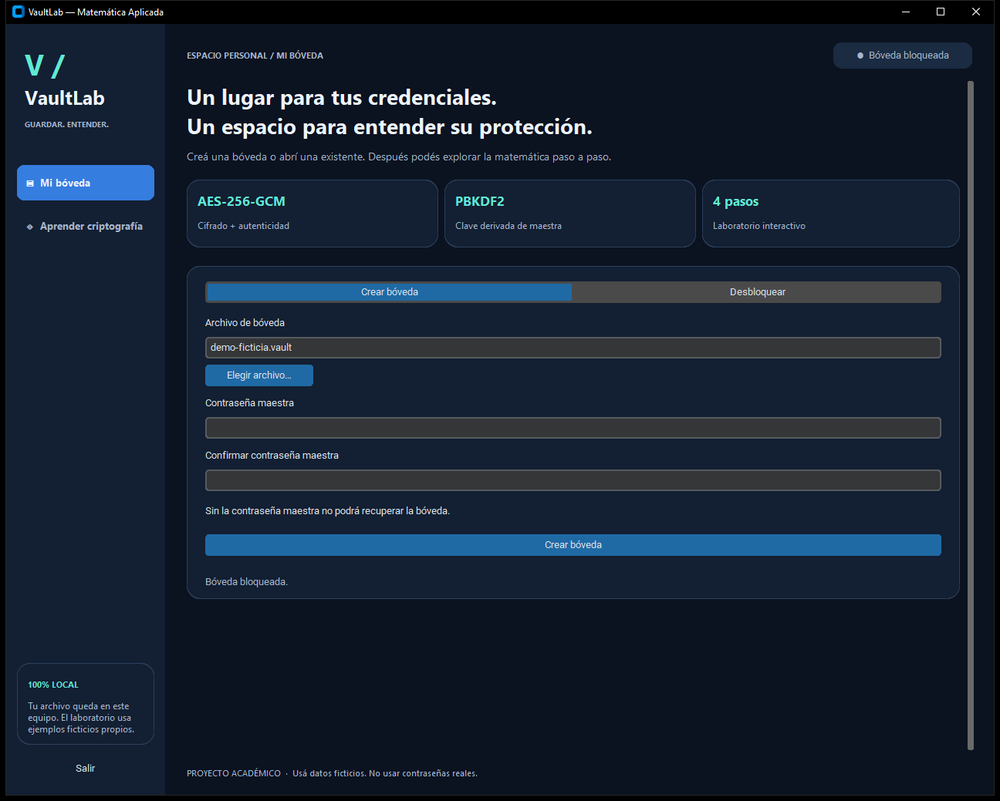
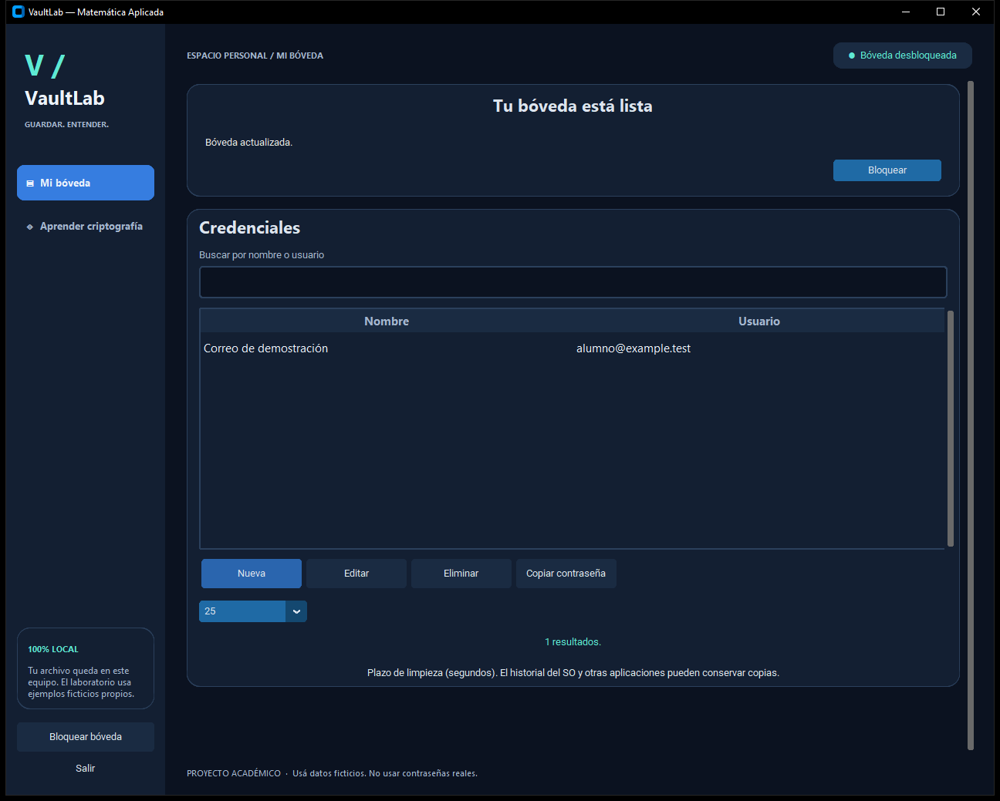
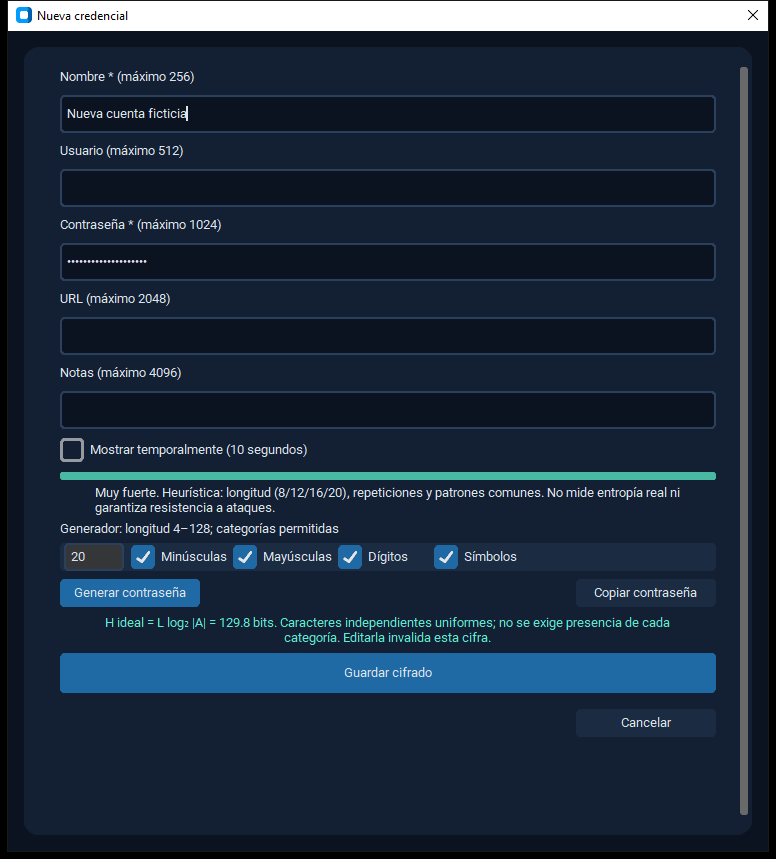
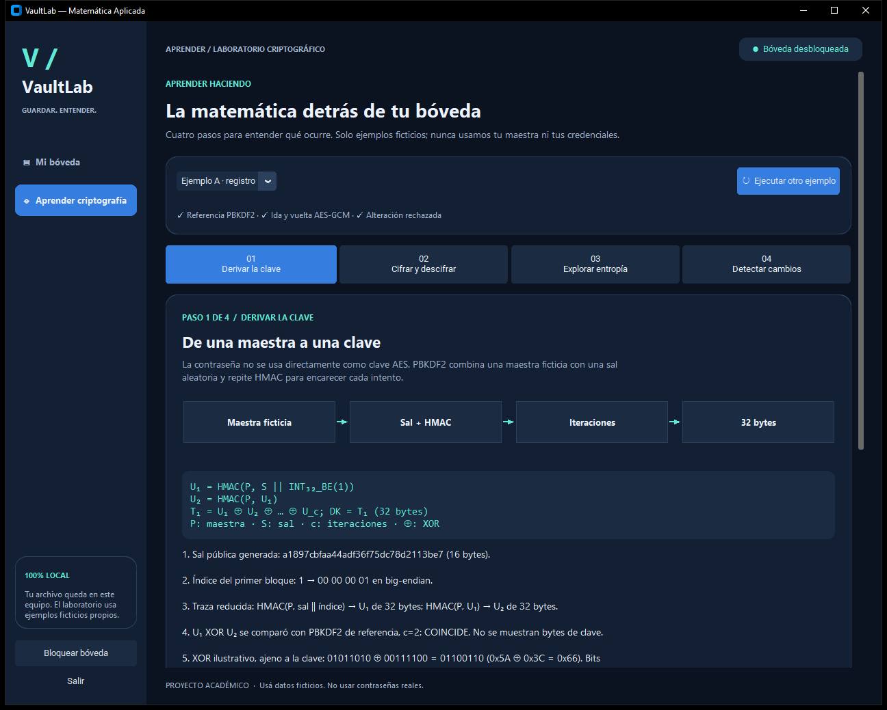

# VaultLab
Administrador de credenciales y laboratorio matemático.
Matemática Aplicada · Borrador para defensa de 15 minutos.
Autoría e institución: completar por el equipo.
Notas: 30 segundos. Aclarar alcance académico y datos ficticios.
---
# Problema y alcance
Conservar credenciales entre sesiones sin escribirlas en claro.
Una bóveda local, un usuario, un proceso; funcionamiento offline.
La GUI también debe explicar operaciones matemáticas verificables.
No protege un equipo infectado ni recupera una maestra perdida.
Notas: 60 segundos. Diferenciar requisitos docentes y decisiones de implementación.
---
# Arquitectura
Interfaz → worker serial → servicios → dominio, criptografía y repositorio.
Los modelos son inmutables y el repositorio solo recibe sobres cifrados.
El estado editado se publica después de confirmar persistencia.
Bloquear descarta resultados tardíos y limpia las referencias de la interfaz.
Notas: 60 segundos. Explicar por qué Tk no ejecuta PBKDF2 ni toca el servicio directamente.
---
# PBKDF2-HMAC-SHA256
U₁ = PRF(P, S || INT₃₂_BE(1)); Uⱼ = PRF(P, Uⱼ₋₁).
T₁ = U₁ XOR … XOR U꜀; DK = T₁ para dkLen = 32 bytes.
Sal aleatoria de 16 bytes; coste inicial 2.400.000 iteraciones.
La traza reducida c=2 del laboratorio se contrasta con hashlib.
Notas: 90 segundos. RFC 8018, sección 5.2. El coste no aumenta la entropía de la maestra.
---
# AES-256-GCM
CTR: Pᵢ XOR AES_K(contadorᵢ) = Cᵢ.
GHASH autentica AAD y ciphertext en GF(2¹²⁸).
Nonce nuevo de 96 bits por escritura; tag de 128 bits.
Cabecera canónica autenticada; se devuelve texto solo tras verificar.
Notas: 60 segundos. NIST SP 800-38D. Sal y nonce son públicos; la clave es secreta.
---
# Acceso local

Notas: 45 segundos. Crear una bóveda nueva con maestra ficticia durante la demo.
---
# Gestión y búsqueda

Notas: 90 segundos. Agregar dos cuentas, editar una, buscar, cerrar y reabrir para probar persistencia.
---
# Generador y fortaleza

Notas: 60 segundos. Categorías permitidas; no se exige presencia de todas. Clave oculta por defecto.
---
# Entropía ideal ≠ fortaleza humana
N = |A|ᴸ; H = log₂ N = L log₂ |A|.
Por defecto: L = 20, |A| = 90, H ≈ 129,84 bits.
Supuestos: elecciones independientes y uniformes con secrets.choice.
La heurística usa longitud y patrones; no estima entropía de entradas humanas.
Notas: 60 segundos. No convertir bits a un tiempo de ataque sin un modelo explícito.
---
# Laboratorio e integridad

Notas: 90 segundos. Ejecutar el laboratorio real. C′[0] = C[0] XOR 1 sobre copia ficticia en memoria.
---
# Copiado y estados de error
Copiado explícito y limpieza tras 20, 25, 30 o 60 segundos si el valor coincide.
Bloqueo y cierre también intentan limpiar lo que aún pertenece a la app.
El historial del SO puede conservar copias; no se promete borrado garantizado.
Maestra incorrecta y alteración comparten error de apertura genérico.
Notas: 45 segundos. Reemplazar el portapapeles por texto ajeno antes del plazo.
---
# Evaluación reproducible
La suite verifica crypto, formato adverso, persistencia, CRUD y GUI real.
Rediseño: 284 aprobadas, sin omisiones ni advertencias; 91,24 segundos.
Se inyectan fallos de escritura y conflictos para comprobar conservación del archivo.
Evidencia y recuento definitivo: FINAL_REPORT.md y evidence/pytest.xml.
El kit offline se instala sin índice; requiere Python con Tk compatible.
Notas: 45 segundos. Mostrar el informe real; no presentar automatización como auditoría externa.
---
# Conclusiones y límites
Gestión persistente, generación y operaciones matemáticas integradas en una app local.
Sin protección contra malware, rollback o escrituras concurrentes entre procesos.
Memoria y portapapeles: limpieza de referencias y esfuerzo limitado.
Pendientes editoriales: autoría, plantilla original y ensayo humano en el equipo de defensa.
Notas: 45 segundos. Autolock y backup manual siguen como mejoras P1.
---
# Referencias y preguntas
RFC 8018, sección 5.2: PBKDF2.
NIST SP 800-38D: GCM y GHASH.
Documentación oficial de Python: secrets.
Bibliografía completa y enlaces verificados en PAPER_DRAFT.md.
Notas: 15 segundos. Reservar tiempo para preguntas y confirmar duración con el docente.
